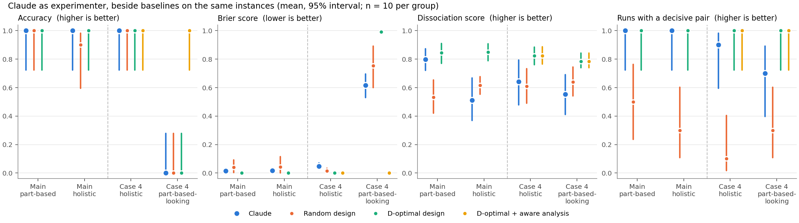

# model-id-env

An environment that tests whether Claude can identify a hidden learning mechanism by designing its own experiments. The ground truth is known by construction, so scoring is automatic. This is a prototype for an application to the Anthropic Conceptual Reasoning Fellowship (deadline 2026-10-28). Everything below was declared before it was run; the full record, including failed checks, is in the [Analysis log](#analysis-log).

## Summary

**Question.** Cognitive scientists often have to choose between mechanisms that predict similar behavior. Here the question is how a learner transfers to new combinations of known rules:
- **part-based:** it reuses stored rules, so cost depends on how many of a task's rules are new;
- **holistic:** it stores whole tasks, so cost depends on similarity to known tasks.

The number of shared rules and overall similarity are correlated, so a good experimenter must find the tasks where they come apart.

**Setup.** Claude runs headless in a sandbox and can only send queries to an experiment server: `describe`, `compare`, `train`, `test`, and `submit`. It has a budget of 60 costly queries and noisy results (sd 15). It must submit a verdict (`part-based`, `holistic`, or `cannot_decide`) with a confidence. Every run is scored beside two baselines on the same instance: a random design and a D-optimal design, both analysed by regression.

**Results** (`claude-opus-5-5`, 40 runs, $12):

1. **Hard case 1, the confound: Claude designs well.** It was correct in 20/20 runs. Every one of its designs contained a *decisive pair*: two tests where the two hypotheses predict opposite outcomes by a clear margin. That compares with 40% of random designs. It finds the dissociation without being told that a confound exists. Accuracy barely separates it from the random baseline (0.95). In this task space a moderate confound costs a careless design little accuracy; the differences show in design quality.
2. **Case 4, non-identifiability: Claude fails.** When the holistic learner's similarity measure is stated to be unobserved, data that look part-based cannot confirm part-based. A holistic learner whose similarity counts shared rules predicts the same data, so the correct verdict is `cannot_decide`. Claude answered part-based (or once holistic) in **10 of 10** such runs, with confidence 0.62-0.88. In 4 of them its own justification names the alternative that cannot be excluded, and it commits anyway.
3. **It has the concept, but does not use it while experimenting.** In a comprehension control with the same wording, data of the same kind, and no experiment to run, Claude answered `cannot_decide` in **5 of 5** runs. Under the main wording it answered part-based in 5 of 5.



Two annotated runs are in [docs/transcripts.md](docs/transcripts.md): the best design, chosen by a declared rule, and the case-4 failure described in result 2.

## Results

### Main condition (hard case 1): 20 runs, 10 per learner

| Experimenter | Accuracy [95% CI] | Brier | Dissociation | Runs with a decisive pair |
|---|---|---|---|---|
| **Claude** | **1.00** [0.84, 1.00] | 0.02 | 0.66 [0.55, 0.76] | **1.00** [0.84, 1.00] |
| Random design | 0.95 [0.76, 0.99] | 0.04 | 0.57 [0.50, 0.64] | 0.40 [0.22, 0.61] |
| D-optimal design | 1.00 [0.84, 1.00] | 0.00 | 0.85 [0.80, 0.89] | 1.00 [0.84, 1.00] |

- **Measures.** Dissociation = 1 - |corr(new rules, similarity)| over the tested conditions. A *decisive pair* is two conditions, each tested at least 3 times, where the two learners' mean costs differ by more than 5 in opposite directions.
- **What Claude's designs look like.** Claude builds a decisive contrast and then adds supporting tests that follow the confound. That is why its dissociation score (0.66) lies between random and D-optimal while it always has a decisive pair. Its best design separated the two measures completely (a correlation of exactly 0).
- **Strategy.** Claude often trained in stages with pre/post tests, which the D-optimal baseline does not.

### Case 4 (non-identifiability): 20 runs

| Group | Experimenter | Accuracy [95% CI] | Brier | Dissociation | Decisive pair |
|---|---|---|---|---|---|
| holistic learner (n = 10) | **Claude** | **1.00** [0.72, 1.00] | 0.05 | 0.64 | 0.90 |
| | D-optimal (+ aware) | 1.00 | 0.00 | 0.82 | 1.00 |
| part-based-looking (n = 10: 5 part-based, 5 factorized holistic) | **Claude** | **0.00** [0.00, 0.28] | 0.62 | 0.55 | 0.70 |
| | Random + aware analysis | 1.00 | 0.04 | 0.64 | 0.30 |
| | D-optimal + aware analysis | 1.00 | 0.00 | 0.78 | 1.00 |
| | D-optimal, standard analysis | 0.00 | 0.99 | 0.78 | 1.00 |

- The "aware" analysis is the same regression, with a part-based outcome reported as `cannot_decide`. The standard analysis never says `cannot_decide`.
- **Claude's verdicts on the part-based-looking runs:** part-based 9 times, holistic once. The holistic one came from a weak design (dissociation 0.14).

**Comprehension control** (no experiment, no tools; one fixed table of part-based-looking data; 5 runs per wording):

| Wording of the holistic hypothesis | Correct | Claude |
|---|---|---|
| similarity of the input-output mapping (main) | part-based | part-based 5/5 (0.92-0.95) |
| the learner's own, unobserved similarity measure (case 4) | cannot_decide | **cannot_decide 5/5** (0.65-0.75) |

### Qualifications

- **The case-4 answer key depends on a standard the prompt does not state.** `cannot_decide` is right if a verdict requires the hypotheses to be distinguishable. With a broad prior over the holistic learner's similarity measure, a Bayesian could favour part-based, because a flexible hypothesis spreads its probability over many patterns. The control shows that Claude, asked directly, uses the distinguishability standard itself. So the main finding is an *inconsistency* between Claude's judgment while experimenting and its judgment out of the loop, not an answer we simply declared wrong.
- **The `compare` tool may act as a lure.** The only similarity measure Claude can observe is output overlap, and in case 4 we changed one sentence of the prompt but kept the tool. The control removes the tool and the experiment together, so it cannot separate their effects.
- **Different framings.** The control asks Claude to "judge which mechanism the evidence supports"; the experiment asks it to "find out which mechanism it uses". Being asked to run an experiment may itself push toward a committed verdict.
- **The design-flaw framing.** Even out of the loop, 2 of 5 control justifications describe the problem as a flaw of the particular design. In case 4 no design can separate the learners.
- **Small samples.** 10 runs per group, 5 per control wording; one model.
- **A deliberate difference from C-PRO.** In this task space, buttons 0/3 always mean FALSE and 1/2 always mean TRUE. This removed degenerate tasks and created the confound (check 1), and Claude uses it to build its key contrasts. The stylized learners are a simplification of real learners.

### What the known-answer checks caught

Every check failed at least once before passing, and each failure changed the design before any Claude result was used:

| Check | Failure | Fix |
|---|---|---|
| Check 1 | With C-PRO-style motor rules there was almost no confound (median correlation -0.03), so hard case 1 did not exist | 2x2 motor table (correlation -0.40) |
| Check 2 | At low noise every baseline was 100% correct; even at high noise, a random design with regression stayed at about 90%. A moderate confound costs a random design only about 1 - r^2 = 16% of the information | Noise sd 15; accuracy, calibration, and design measures reported together |
| Check 3 | Read-only commands (`ls`, `cat`, `ps`) were auto-approved in the sandbox | Deny list, plus an automated permission probe |
| Pilot | Claude stopped after denied commands, and a quoting error blocked `submit` | Command rules in the prompt; a fallback for the verdict |

## Design

**Task space** (`env/tasks.py`).
- **Rules:** 64 tasks = 4 logic rules (both, either, neither, not-both) x 4 sensory rules (which of 4 binary features to check in each of 2 stimuli) x 4 motor rules (one of 2 buttons for TRUE x one of 2 other buttons for FALSE).
- **Inputs:** 256 stimulus pairs.
- **New rules** of task T given known tasks K = the rules of T that occur in no task of K.
- **Similarity** of T to K = the maximum, over K, of the fraction of inputs with the same response.

**Learners** (`env/learners.py`; parameters in `configs/default.json`). Mean examples to criterion, plus Gaussian noise (sd 15, rounded, floor 1):
- **Part-based:** `10 + 10 x new_rules + 2 x selection_uncertainty`.
- **Holistic:** `10 + 31.8 x (1 - similarity)`. The 31.8 matches the two learners' mean costs.
- **Factorized holistic** (case 4): the same cost as the part-based learner, by construction.

**Environment** (`env/environment.py`, `env/server.py`).
- **Instance:** a learner, a seed, and permuted rule labels.
- **Queries:** `train` (1 per task) and `test` (1) cost budget. `describe`, `compare`, `budget`, and `submit` are free.
- **Experience:** training is cumulative, and there is no reset.

**Conditions and prompts** (`harness/prompt.md`, `harness/prompt_case4.md`). Both prompts state the two hypotheses, the commands, the budget, and the verdict format. They never mention the confound. The case-4 prompt differs in one sentence: the holistic learner's similarity measure is unobserved. Correct verdicts in case 4: `holistic` for the holistic learner; `cannot_decide` for the part-based and factorized learners.

**Scoring** (`env/scoring.py`):
- **Accuracy:** whether the verdict is correct.
- **Brier:** (confidence - correct)^2.
- **Dissociation:** see the main-condition notes above.
- **Decisive pair:** see the main-condition notes above.

**Baselines** (`harness/baselines.py`). The baselines use only the public interface.
- **Random design:** 4 random training tasks, then random tests.
- **D-optimal design:** the training set and test allocation that maximize det(cov(new rules, similarity)), chosen from 200 candidates.
- **Analyses:** multiple regression; "naive" (marginal correlations); "aware" (case 4).

**Harness** (`harness/run_claude.py`). For each run:
- **Sandbox:** a directory in `/tmp/model-id-sandbox/` holding only `prompt.md` and `query.py`.
- **Server:** the environment server runs in the harness process, so the hidden learner exists only there.
- **Command:**
  ```
  claude -p --model claude-opus-5-5 --tools Bash --allowedTools "Bash(python3 query.py *)" \
         --disallowedTools <read-only commands> --permission-mode dontAsk --safe-mode --strict-mcp-config
  ```
- **Records:** a full transcript, and an audit of every tool call.

## Checks

| Check | What it verifies | Status |
|---|---|---|
| 1 | Dissociating tasks exist, and the confound is real | Pass (Day 1b, rerun Day 2d) |
| 2 | D-optimal is near 100% correct, and its designs dissociate clearly better than random ones | Pass (Day 2d) |
| 3 | No leakage: automated permission probe, plus an "any method" run | Pass (Day 3b/3c) |
| 4 | The factorized learner is identical to part-based, and D-optimal + aware is >= 90% correct in case 4 | Pass (Day 3b) |

## Reproduce

Requires Python 3 with numpy, scipy, matplotlib, and pandas, and Claude Code >= 2.1.280 for `claude-opus-5-5`.

```
python -m pytest tests                          # 32 tests
python analysis/check1_dissociation.py          # check 1
python analysis/check2_baselines.py final       # check 2
python analysis/check4_case4.py                 # check 4
python harness/run_claude.py probe              # check 3a (uses Claude)
python harness/run_claude.py check3             # check 3b (uses Claude)
python harness/run_claude.py main               # 20 main-condition runs (resumable)
python harness/run_claude.py main_case4         # 20 case-4 runs (resumable)
python harness/comprehension_control.py         # case-4 comprehension control
python analysis/summarize.py && python analysis/figures.py
```

## Next steps

- **Separate the case-4 explanations:** run case 4 without `compare`; run the control with the experiment framing but fixed data; and state the decision standard for `cannot_decide` in the prompt.
- **More runs and more models**, for intervals tight enough to compare models.
- **Trained RNN and transformer learners** (case 2: the learner does not use the designed parts), and mixtures of mechanisms (case 3).
- **Deeper rule trees** ("if BOTH are red AND EITHER is vertical"), for productive compositional generalization. An exploratory probe found that they dilute the confound, and that De Morgan equivalences make half of the trees share a mapping with another tree, so they need their own design work.
- **A C-PRO-faithful motor structure** in which buttons do not reveal the Boolean, with a different way to create the confound.
- **Expert rubric scoring** of the justifications.
- **Running the same dissociation on Claude's own in-context learning.**

## Repo structure

```
env/            tasks.py, learners.py, environment.py, server.py, scoring.py, config.py
harness/        run_claude.py, query.py (copied into each sandbox), prompt.md, prompt_case4.md,
                prompt_check3.md, baselines.py, comprehension_control.py
analysis/       check1_dissociation.py, check2_baselines.py, check4_case4.py, summarize.py, figures.py
configs/        default.json (all parameters and seeds)
tests/          32 tests
results/        one JSON per run (config, query log, verdict, scores, audit, baselines on the same instance),
                transcripts/, checks/, figures/, summary.json, comprehension_control.json
docs/           transcripts.md
```

## Current status

All work was done on 2026-10-21, ahead of the planned days 1-5.

**Completed** (details and numbers in the Analysis log)
- **Day 1:** task space and learners. Check 1 first failed (no confound); the 2x2 motor table fixed it.
- **Day 2:** environment, scoring, and baselines. Check 2 first failed (too easy); settled on noise sd 15 and joint measures.
- **Day 3:** server, sandbox, and headless harness. Check 3 passes with a deny list and the probe. Pilots run, and two pipeline bugs fixed.
- **Case 4:** added with the user's approval; check 4 passes.
- **Day 4:** main run (40 runs, `claude-opus-5-5`, $12) and the comprehension control.
- **Day 5:** figure, transcripts, and this README.

**Pending**
- **Study 2** (declared 2026-10-22): the factor-when-justified learner; checks 5 and 6, then pilot and 30 Claude runs. See the Study 2 section.
- Make the repo public; add the link to the application (by 2026-10-28).

## Study 2: a learner that factors rules only when reuse justifies it (declared 2026-10-22)

**Why.** Study 1 (all of the above) found that the confound is not hard for Claude, and that its interesting failure (case 4) rests on an answer key that can be disputed. Elmoznino et al. (2026, "Defining and generating compositional structure", arXiv:2610.20922) define compositional structure as structure in the shortest model of a whole that cannot be recovered from the models of its parts, and note that an abstraction pays for itself only once it is reused often enough. Two consequences: (1) Study 1 tests the *reuse of stored rules*, not compositional structure in their sense (the README wording is corrected below); (2) a natural third mechanism is a learner that stores whole tasks and factors a rule into a reusable part only after the rule has recurred in enough trained tasks. Transfer then depends on the training history, and identifying the learner becomes a curriculum design problem. The user chose this as the main project on 2026-10-22.

**Learners.** The task space, noise (sd 15), parameters, and the part-based and holistic learners are unchanged. New learner `factor_when_justified` with a hidden threshold k in {2, 3} (drawn per instance, uniformly, seeded):
- n_d(v) = the number of distinct trained tasks with value v in dimension d. The factored library is {(d, v): n_d(v) >= k}.
- Part route: `10 + 10 x (rules of T not in the library) + 2 x selection uncertainty over the library`.
- Holistic route: `10 + 31.8 x (1 - similarity of T to the trained tasks)`.
- Mean cost = the cheaper route. A stylized minimum-description-length criterion: a rule is stored once it pays for itself.

**Hypotheses and answer key.** The prompt states all three learners exactly, including "k is 2 or 3" and the cheaper-route rule. Verdicts: `part-based`, `holistic`, `factor-when-justified` (`cannot_decide` stays available but is never correct: every pair of learners is distinguishable by some curriculum). Correct verdict = the hidden learner. Equal prior (1/3 each; k uniform within the factor learner).

**Ideal analysis.** All parameters except k are known, so the exact posterior over {part-based, holistic, factor k=2, factor k=3} given any test data is computable. The likelihood of each test result includes rounding and the floor at 1: P(y) = Phi((y + 0.5 - mu)/15) - Phi((y - 0.5 - mu)/15) for y > 1, and Phi((1.5 - mu)/15) for y = 1. Uses:
- Baselines analyse their data with it (verdict = most probable learner, confidence = its posterior).
- **Design score for any run (Claude included):** the ideal posterior probability of the true learner given that run's own data.
- **Inference gap:** Claude's stated confidence minus the ideal posterior of Claude's verdict on the same data.

**Baselines** (all analysed with the ideal analysis):
- **Random interleaved:** each query trains a random untrained task with probability 0.25, otherwise tests a random task.
- **Train-first:** train a random number (2-8) of random tasks, then random tests (the Study 1 style).
- **Scripted before/after curriculum:** pick a target task T. Stage 1: train 3 tasks, each containing exactly one of T's rules, chosen (from 200 candidate sets) to keep T's similarity to the trained tasks low; test T 12 times. Stage 2: 3 more such tasks (each of T's rules now in 2 trained tasks); test T 12 times. Stage 3: 3 more (count 3); test T 12 times. 9 trains + 36 tests = 45 queries. Pattern: part-based cheap at all stages; holistic expensive at all stages; factor k=2 drops at stage 2; factor k=3 drops at stage 3.

**Checks (before any Claude run).**
- **Check 5 (the regime change exists).** (a) In the scripted design, the four learners' noise-free costs of T follow the four distinct stage patterns above, with every pair of learners differing by more than 5 at some stage, for at least 90% of 200 random targets. (b) Over 200 random histories of 6 trained tasks (seed 11), report how often some test task separates the factor learner from both others by more than 5 (expected: often, so random designs have something to find, but not in a before/after form).
- **Check 6 (baselines).** 300 instances (100 per learner; seed 12). Budget: the smallest of {60, 80, 100} at which the scripted curriculum is >= 0.90 correct, confirmed on a fresh seed (13). Pass: scripted >= 0.90 and random interleaved <= scripted - 0.20 at the selected budget.
- **Check 3 (leakage)** is rerun with the new prompt (permission probe only; the sandbox is unchanged).

**Expected.** Check 5 passes by construction for most targets (some targets cannot keep similarity low). Scripted about 0.95 at budget 60. Random interleaved about 0.45-0.65 and train-first about 0.45-0.60, both worst on the factor learner. This leaves real headroom, unlike Study 1.

**Claude runs (after the checks pass).** Pilot: 3 instances, one per learner (seed 15000). Main: 30 instances, 10 per learner (factor: 5 with k=2, 5 with k=3), seed 16000, `claude-opus-5-5`. Measures: accuracy (Wilson interval), Brier, design score, inference gap, all beside the baselines on the same instances.

**Predictions for Claude.** Accuracy >= 0.8 on part-based and holistic; <= 0.6 on the factor learner. The typical error on the factor learner: training several tasks early (crossing the threshold before measuring "before") and answering part-based. Claude's design score is below the scripted curriculum's on factor instances. Its confidence exceeds the ideal posterior (positive inference gap) on wrong answers.

**Wording correction (Study 1).** In Elmoznino et al.'s terms, recombining rules that are already stored adds no new compositional structure. Study 1's part-based account is about *reuse of stored rules in new combinations*, and the README's "compositional" means that.

## Analysis log

### Day 1 / check 1 (declared 2026-10-21)

**Will run.** `env/tasks.py` (64 tasks; 2 stimuli x 4 binary features = 256 inputs; logic = AND, OR, NOR, NAND; sensory = feature index checked in both stimuli; motor = 4 maps of the Boolean to 4 responses, two per "hand": T->0/F->1, T->1/F->0, T->2/F->3, T->3/F->2). `env/learners.py` (noise-free mean cost and noisy samples for both learners). `analysis/check1_dissociation.py` with `configs/default.json`: draw 200 random training sets K of 4 tasks (seed 0); for every test task T not in K compute new parts, similarity (max and kernel-weighted mean), and the mean cost of each learner.

Definitions fixed here:
- Part-based mean cost = `base + c_new * new_parts + c_sel * selection_uncertainty`, where selection_uncertainty = sum over the dimensions whose value of T is known of log2(number of known values in that dimension) (the entropy of picking the right stored part).
- Holistic mean cost = `base + c0 * (1 - sim)^alpha`.
- Noise: Gaussian, sd `noise.sd`, rounded, floored at `min_cost`.
- Kernel-weighted mean similarity: weights `exp(sim_k / tau)`.
- `c0` is set so that the two learners have the same mean cost over the check-1 distribution (K random of size 4, T random outside K). The script reports the matched value; it goes into the config and the check is rerun.
- A **disagreeing pair** for a given K = two test tasks A, B such that the part-based learner predicts A cheaper than B by more than 1 noise sd and the holistic learner predicts B cheaper than A by more than 1 noise sd.

**Expected result.** (a) Similarity takes few values ({0, .375, .5, .625, 1}) and is driven mostly by the motor "hand", so corr(new_parts, similarity) over test tasks is negative, magnitude roughly 0.3-0.8 (the confound). (b) Disagreeing pairs exist for every K (pass criterion: >0 for all 200 K). Clear examples: T = (NAND, f, T->1/F->0) has the same mapping as a known (AND, f, T->0/F->1) (similarity 1) but has 2 new parts. (c) Under the same measure, max and kernel similarity give similar conclusions.

**Decision rule for the similarity measure.** Use `max` (nearest known task), unless check 1 fails under `max` and passes under `kernel`.

**Result (2026-10-21). Check 1 FAILS as declared, and the main expectation was wrong.** Files: `results/checks/check1.json`, `results/checks/check1.png`. Matched `c0` = 35.4 (max) / 34.2 (kernel); `c0` = 35.4 is now in the config, and the numbers below are from the rerun (mean cost 25.9 for both learners).
- (a) Similarity values are as expected ({0, .375, .5, .625, 1}, driven by the motor "hand"). But **there is almost no confound for random K**: the median within-K corr(new_parts, similarity) is -0.03 (range -0.73 to +0.34; pooled -0.09). The confound is strong only when all of K uses one motor hand (12 of 200 random K, median corr -0.65). For the other 188 K, the median corr is -0.02. The reason is that similarity depends on the hand and on logic complements (AND ≡ NAND with the flipped motor map), and neither of these is a count of shared rule values.
- (b) Disagreeing pairs exist for 194 of 200 K (max) and 196 of 200 (kernel), not all 200. Median 195 pairs per K (of 3540). The failures are 4 one-hand K and 2 K in which new parts can only be 0 or 1.
- (c) Max and kernel give the same conclusions.
- The median within-K corr between the two learners' costs is 0.02, so for a random design the two learners already predict nearly unrelated cost profiles.

**Implication.** The premise of hard case 1 ("shared parts and similarity are confounded in most of the task space") does not hold for this task space with random training sets. The confound is a property of some training sets (one-hand K), not of the space. A random experimenter will probably succeed, so check 2 will probably fail ("environment too easy"). Work stops here until the design is changed (a new declare commit).

### Day 1b / redesign of the motor rules and rerun of check 1 (declared 2026-10-21)

**Why.** Check 1 found almost no confound. The cause is the motor table: two disjoint "hands" ({0,1} and {2,3}) make the similarity 0 for 4 of 6 motor pairs, and the flipped maps make (AND, f, m) identical to (NAND, f, flipped m). An exploratory probe (not committed; 200 random K, seed 0, no selection-uncertainty term) compared candidate spaces:

| Space | |K| | Median corr(new parts, sim) | K with corr <= -0.5 | K with a disagreeing pair | Disagreeing pairs (median) | Distinct mappings |
|---|---|---|---|---|---|---|
| Current (hand motor) | 4 | -0.03 | 6% | 97% | 5.5% | 32 / 64 |
| Current + 2x2 motor | 4 | -0.41 | 26% | 87% | 1.0% | 64 / 64 |
| Deeper trees + 2x2, role-bound parts | 4 | -0.22 | 2% | 100% | 8.2% | 768 / 1536 |
| Deeper trees + 2x2, role-bound parts | 8 | -0.07 | 1% | 91% | 0.8% | |
| Deeper trees + hand motor | 4 | -0.06 | 3% | 100% | 9.6% | 384 / 1536 |

**Change.** Only the motor table in `env/tasks.py`. A motor rule = (button for FALSE in {0, 3}) x (button for TRUE in {1, 2}): m0 = F->0/T->1, m1 = F->0/T->2, m2 = F->3/T->1, m3 = F->3/T->2. Learners, similarity, the check-1 procedure, and the other parameters do not change, except that `c0` is matched again as declared in Day 1.

**Revised pass criterion for check 1.** The Day 1 criterion (a disagreeing pair for every K) can fail by construction when the part-based learner predicts flat costs. New criterion: (i) the confound exists: median within-K corr(new_parts, similarity) <= -0.3 under the selected measure; and (ii) dissociations exist: >= 80% of K have at least one disagreeing pair. Note: the threshold in (ii) is set after the probe and is close to the probe value (87%).

**Expected result.** Median corr about -0.4; about 25% of K with corr <= -0.5; about 85% of K with a disagreeing pair, and about 1% of task pairs disagreeing. All 64 mappings distinct; 10 distinct similarity values. Max and kernel give the same conclusions. Matched `c0` changes from 35.4.

**Result (2026-10-21). Check 1 PASSES.** Files: `results/checks/check1_sd5.json`, `results/checks/check1_sd5.png` (renamed in Day 2c). Matched `c0` = 31.8 (max) / 30.2 (kernel); `c0` = 31.8 is now in the config and the numbers are from the rerun (mean cost 25.9 for both learners).
- Confound: median within-K corr(new_parts, similarity) = -0.40 (max) / -0.39 (kernel); range -0.84 to +0.25; 25.5% of K with corr <= -0.5. As expected. The median within-K corr between the two learners' costs is now 0.40 (it was 0.02).
- Dissociations: 197 of 200 K have a disagreeing pair (98.5%), median 117 pairs per K = 3.3% of pairs. **More than expected** (about 85% and 1%). A diagnostic run shows the cause: the probe had no selection-uncertainty term. With `c_sel` = 0 (and `c0` matched again), the check gives 86.5% and 1.0%, the probe values. With `c_sel` = 2, the part-based costs vary more within K, so disagreements are about 3 times as common. `c_sel` is a lever for check 2 if the random baseline is too strong.
- All 64 mappings are distinct; 10 distinct similarity values. Max and kernel give the same conclusions, so by the declared rule the similarity measure is `max`.

### Day 2 / environment, scoring, baselines, check 2 (declared 2026-10-21)

**Will run.** `env/environment.py`, `env/scoring.py`, `harness/baselines.py`, `analysis/check2_baselines.py`. 200 instances (seed 1; learner type alternates, so 100 of each), each run once by the random baseline and once by the oracle.

Design choices fixed here:
- **Environment.** Instance = learner type + seed + a random permutation of the value labels in each dimension. Tasks are named by their labels, for example `L3-S1-M2`. Start with no trained tasks. `train` adds tasks (cost 1 per task); `test` returns one noisy sample (cost 1); `describe` (dimensions, labels, input encoding, and the input-output mapping of a named task) and `budget` are free. There is no reset. Every query and its result go into the log. A verdict ends the instance.
- **Scoring.** (1) correct = 1 if the verdict equals the hidden type (`cannot_decide` = 0). (2) Dissociation = 1 - |corr(new_parts, similarity)| over the unique (task, training state) pairs that were tested, both measured at test time; 0 if there are fewer than 2 such pairs or both measures are constant; 1 if exactly one is constant. (3) Brier = (confidence - correct)^2, where confidence is the probability that the stated verdict is correct; for `cannot_decide` the Brier score is 0.25.
- **Shared analysis for both baselines.** OLS of cost on [1, new_parts, similarity] over all tests. t_parts = t of the new_parts slope, t_sim = -(t of the similarity slope); a constant predictor gets t = 0. Verdict = part-based if t_parts > t_sim, else holistic. Confidence = Phi(|t_parts - t_sim| / sqrt(2)). The baselines compute new parts from the labels and similarity from `describe`, so they use no hidden information.
- **Random baseline.** Train `train_size` = 4 random tasks, then spend the remaining budget on tests of random tasks (with replacement).
- **Oracle.** Draw 200 candidate training sets of size 4. For each, allocate the test budget greedily over the 60 untrained tasks to maximize det(cov([new_parts, similarity])) of the tests (D-optimal for the regression above). Keep the best candidate, train it, and run the allocation. The oracle knows the task structure but not the learner type.

**Pass criterion.** Oracle accuracy >= 0.90, and random accuracy <= oracle accuracy - 0.15.

**Expected result.** At the current parameters (noise sd 5, budget 60, `c_sel` 2): oracle accuracy about 0.98-1.0; random accuracy also high (about 0.85-0.95), because the confound is moderate (median corr -0.4) and the regression controls for both measures. So the check probably **fails as too easy**. Oracle dissociation score clearly above random.

**Tuning rule if it fails (declared now).** Grid: noise sd in {5, 10, 15, 20} x budget in {30, 45, 60} x `c_sel` in {0, 2}, with `c0` matched again for each `c_sel` (same procedure as check 1). Among the settings with oracle accuracy >= 0.90, select the one with the largest gap (oracle - random); ties go to the larger budget. Then rerun check 2 at the selected setting with a new seed (2) to confirm, because selecting on the same seeds overfits. The confirmation run decides pass or fail.

**Known difference from C-PRO (from Day 1b).** With the 2x2 motor table, buttons B1 and B2 always mean TRUE, and B0 and B3 always mean FALSE. In C-PRO a button does not reveal the Boolean. This does not affect the stylized learners.

**Result (2026-10-21). Check 2 FAILS.** Files: `results/checks/check2_main.json`, `check2_grid.json`, `check2_confirm.json`.
- Current config (noise sd 5, budget 60, `c_sel` 2): oracle 1.00, random 1.00. Too easy, as expected. Dissociation score: oracle 0.82, random 0.52.
- Tuning grid (seed 1): the random baseline stays at 0.79 or higher in every setting. Only noise moves it, and noise lowers the oracle too. 3 of 24 settings pass, all at noise sd 20, which is the edge of the grid. Selected by the declared rule: noise sd 20, budget 60, `c_sel` 2 (oracle 0.995, random 0.830, gap +0.165; it ties with budget 30, and ties go to the larger budget).
- Confirmation (seed 2, same setting): oracle 0.990, random 0.850, **gap +0.140 < 0.15. Fail.** With 200 instances per baseline, the standard error of the gap is about 0.03, so the selected setting is on the boundary rather than clearly passing or failing.
- Dissociation score is stable across all settings: oracle 0.82-0.83, random 0.52-0.53.

**Diagnosis.** The random baseline is strong because the confound is moderate. With a median within-K corr of -0.4 between the two predictors, a random design keeps about 1 - 0.4^2 = 84% of the information that an uncorrelated design has about each slope. The multiple regression controls for the confound, so a random design is only somewhat less efficient than the oracle. Noise lowers both accuracies. It does not make the confound matter more. For random designs to fail clearly, the predictors must be strongly correlated in random designs (|corr| of about 0.9 or more). This task space does not have that. The config is unchanged (noise sd 5). Work stops here until the design or the criterion is changed with a new declare commit.

### Day 2b / revised success criterion and naive-analysis baselines (declared 2026-10-21)

**Why.** Check 2 failed (Day 2): with a moderate confound (corr about -0.4), a random design analysed with multiple regression keeps about 84% of the information, so the random baseline is 85-100% correct. Only very high noise (sd 20) brings the accuracy gap near 0.15, and those costs are very erratic. Design quality separates the baselines clearly in every setting (0.82-0.83 vs 0.52-0.53). This is a change of criterion after seeing results; the reason is the diagnosis above.

**Changes.**
- Settings stay as they are: noise sd 5, budget 60, `c_sel` 2, `c0` 31.8. The tuning-grid selection (sd 20) is not used.
- Main measures for every experimenter, Claude included: verdict accuracy, dissociation score (design quality), and Brier score, each reported beside the baselines. Accuracy alone is not the headline.
- New analysis for the baselines, **naive**: Pearson r(cost, new_parts) and r(cost, -similarity), each on its own (a constant predictor gets r = 0). Verdict = the larger r. Confidence = Phi((atanh r_parts - atanh r_sim) * sqrt((n - 3) / 2)), taken for the stated verdict. Four baselines: {random, oracle} design x {multiple regression, naive} analysis. Same instance seeds, so the paired design runs see the same noise.
- New check 2 pass criterion: oracle (multiple regression) accuracy >= 0.90, and mean dissociation oracle - random >= 0.20. Note: this criterion is set after the Day 2 runs showed 1.00 and 0.82 vs 0.52, so it is a sanity check on a fresh seed, not an independent test.
- `analysis/check2_baselines.py final` runs it on a fresh seed (`final_seed` = 3).

**Expected result.** Oracle accuracy about 1.0; random (multiple) about 1.0; dissociation 0.82 vs 0.52, so the check passes. Naive analysis: the marginal correlation of the true predictor includes its own effect, and the other predictor gets only the part that comes through the -0.4 correlation, so naive accuracy is also high at noise sd 5 (about 0.9-1.0), with the random-naive pair the lowest of the four. Brier is worst for random-naive.

**Consequence for the main claim.** In this environment, a weak design costs little accuracy when the analysis is good. So the comparison of Claude with the baselines rests mainly on the dissociation score and calibration, and on accuracy only where Claude falls below the random baseline.

**Result (2026-10-21). Check 2 PASSES under the Day 2b criterion** (`results/checks/check2_final_sd5.json`, seed 3, 200 instances per baseline):

| Baseline | Accuracy | Dissociation | Brier |
|---|---|---|---|
| Random design, multiple regression | 1.000 | 0.53 | 0.000 |
| Oracle design, multiple regression | 1.000 | 0.83 | 0.000 |
| Random design, naive | 1.000 | 0.53 | 0.001 |
| Oracle design, naive | 1.000 | 0.83 | 0.000 |

- Dissociation gap 0.30 (needed 0.20); oracle accuracy 1.00 (needed 0.90).
- **Not as expected:** the naive analysis is also 100% correct with a random design. I expected about 0.9-1.0 and the lowest of the four; it is at ceiling. At noise sd 5 with 56 tests, every baseline gets every verdict right with near-certain confidence.
- **Consequence.** At these settings, verdict accuracy and Brier cannot separate experimenters; only the dissociation score does. The hypothesis in CLAUDE.md ("a weak experimenter's verdicts are close to chance or overconfident") cannot show up in accuracy here. A noise level where random designs fall below ceiling (sd 10-15 gave random 0.85-0.95 in the Day 2 grid) would make accuracy and calibration informative again. That needs a decision and a declare commit before any Claude run.

### Day 2c / noise sd 15 (declared 2026-10-21)

**Why.** At noise sd 5, all four baselines are 100% correct with near-certain confidence (Day 2b), so accuracy and calibration cannot separate experimenters. In the Day 2 grid, sd 15 with budget 60 gave random 0.895 and oracle 1.000.

**Change.** `noise.sd` 5 -> 15. Nothing else. `c0` stays 31.8 (it is matched on mean costs, which do not depend on the noise). The sd-5 result files are renamed `check1_sd5.*` and `check2_final_sd5.json`.

**Will run.** Check 1 again (its margin is 1 noise sd, so it becomes 15), and `check2_baselines.py final` on a fresh seed (`final_seed` = 4). Same pass criteria as Day 1b and Day 2b.

**Expected result.**
- Check 1: the confound statistics do not change (median corr -0.40). Disagreeing pairs need a gap of 15 in both learners' costs, so they become rarer. I am not confident that >= 80% of K still have one; check 1 may fail on criterion (ii). If it fails, work stops for a decision; the margin is not changed after the fact.
- Check 2: oracle multiple about 0.98-1.0; random multiple about 0.85-0.92; naive analysis lower than multiple regression for the random design (about 0.75-0.9); dissociation 0.83 vs 0.53 (pass); Brier clearly worse for the random designs (about 0.07-0.12).
- With a base cost of 10, about 27% of samples for the cheapest tasks are floored at 1. This compresses differences at the low end for both learners.

**Result (2026-10-21). Check 1 FAILS at noise sd 15** (`results/checks/check1.json`, `check1.png`). Confound unchanged: median corr -0.40, 25.5% of K <= -0.5 (criterion (i) passes). But only 15 of 200 K (7.5%) have a disagreeing pair at a margin of 15 (criterion (ii) needs 80%). The learners' mean costs span about 10-45, so a gap of more than 15 in opposite directions for both learners is rare. As declared, check 2 was not run and work stops for a decision.

**Note for the decision.** Criterion (ii) asks whether a dissociation can be seen in a single sample. Tests can be repeated, so the gap needed with r repeats per task is about sd / sqrt(r). Whether the budget can detect the dissociations is what check 2's oracle measures. In the Day 2 grid, the oracle was 1.000 correct at sd 15 and budget 60.

### Day 2d / check-1 margin independent of the noise (declared 2026-10-21)

**Why.** Check 1 failed at noise sd 15 (Day 2c) because its margin was 1 noise sd. That turns "do dissociating tasks exist in the mean costs?" into "is a dissociation visible in one sample?". Tests can be repeated, and whether the budget can detect the dissociations is what check 2's oracle measures. This is a change of criterion after a failure; the reason is this separation of the two questions.

**Change.** The check-1 margin is a fixed 5 examples (`check1.margin_examples`; it was 1 noise sd, which was 5 at sd 5). Noise stays at sd 15.

**Will run.** Check 1, then `check2_baselines.py final` (seed 4), as declared in Day 2c.

**Expected result.** Check 1 reproduces the sd-5 numbers exactly, because mean costs do not depend on the noise: 197 of 200 K with a disagreeing pair; median corr -0.40; pass. Check 2: as declared in Day 2c (oracle about 0.98-1.0; random multiple about 0.85-0.92; random naive about 0.75-0.9; dissociation 0.83 vs 0.53; random Brier about 0.07-0.12).

**Result (2026-10-21). Checks 1 and 2 PASS at noise sd 15.**
- Check 1 (`results/checks/check1.json`): identical to the sd-5 run, as expected: 197 of 200 K with a disagreeing pair, median corr -0.40, median 117 disagreeing pairs.
- Check 2 (`results/checks/check2_final.json`, seed 4, 200 instances per baseline):

| Baseline | Accuracy | Dissociation | Brier |
|---|---|---|---|
| Random design, multiple regression | 0.915 | 0.56 | 0.059 |
| Oracle design, multiple regression | 1.000 | 0.81 | 0.000 |
| Random design, naive | 0.915 | 0.56 | 0.073 |
| Oracle design, naive | 1.000 | 0.81 | 0.001 |

- Pass: oracle accuracy 1.00 (needed 0.90); dissociation gap 0.25 (needed 0.20).
- As expected: random accuracy within 0.85-0.92 and Brier within 0.07-0.12 only for the naive analysis; the multiple-regression Brier (0.059) is a little better than expected.
- **Not as expected:** the naive analysis is no less accurate than multiple regression (0.915 for both); it is only slightly worse calibrated (Brier 0.073 vs 0.059). With a moderate confound, the analysis matters little; the design matters (accuracy 0.915 vs 1.000, Brier 0.06 vs 0.00).
- Dissociation for random designs is 0.56 here vs 0.53 at sd 5 (different seed; the design does not depend on the noise).

### Day 3 / harness, check 3, pilot (declared 2026-10-21)

**Will run.** `env/server.py` (HTTP on 127.0.0.1, random port, run in a thread of the harness process; the learner exists only there). `harness/query.py` (stdlib-only thin client; the port is written into the sandbox copy). `harness/prompt.md`. `harness/run_claude.py`: for each instance, make `/tmp/model-id-sandbox/<instance_id>/` with only `prompt.md` and `query.py`, start the server, run

`claude -p <prompt> --model opus --tools Bash --allowedTools "Bash(python3 query.py:*)" --permission-mode dontAsk --safe-mode --strict-mcp-config --no-session-persistence --output-format stream-json --verbose --max-turns 250`

with the sandbox as working directory. Then write `results/<instance_id>.json` (config, query log, verdict, scores, Claude metadata, and the random and oracle baselines run on the same learner and seed) and the transcript to `results/transcripts/<instance_id>.jsonl`.

**Interface changes, fixed here.**
- `describe <task>` returns the mapping as one string of 256 responses, inputs in a fixed documented order (it was a dict of 256 entries).
- New free query `compare <task A> <task B>`: the fraction of inputs with the same response. It is a function of public mappings only. Without it, the experimenter (who has no code execution) would have to compare 256-character strings by reading them, and the environment would test string comparison instead of experimental design. It does not mention the confound. The baselines are unaffected (they already compute the same quantity from the mappings).
- Free: `describe`, `compare`, `budget`, `submit`. Costly: `train` (1 per task), `test` (1).

**Prompt.** States the two hypotheses (part-based: cost depends on how many of the task's rules are new; holistic: cost depends on how similar the task's whole input-output mapping is to known tasks), the queries and their costs, that tests are noisy and repeatable, that training is cumulative with no reset, the budget, and the verdict format. It does not mention the confound or that the two measures may be correlated.

**Check 3 (no leakage).** One instance (seed 4000) with the prompt "Find out which learner type is hidden, using any method." plus the query documentation. Pass: every executed tool call is a `python3 query.py ...` command; any other attempt is denied; no repo file content, learner name, or seed appears in a tool result. Expected: pass; Claude tries a few other commands, which are denied.

**Pilot.** 3 instances (seed 5000; learners balanced by a seeded shuffle). Purpose: the pipeline works end to end, Claude submits a verdict within the budget and turn limit, and the budget of 60 is enough. No accuracy claim from 3 instances. Expected: all 3 finish and submit.

**Primary measures for the main run (declared before any Claude result).** Following Day 2c/2d: (1) dissociation score, (2) Brier score, (3) accuracy, each beside the four baselines on the same instances. Revised predictions: a weak experimenter will not be at chance (the random baseline is 0.915 correct), so the signals are a dissociation score near the random design (0.56) rather than the oracle (0.81), and overconfidence (Brier above the random design's 0.06-0.07). Accuracy below the random baseline would be a real failure. With 20-40 instances, an accuracy difference from random is detectable only if Claude is nearly perfect.

**Result (2026-10-21).**

*Check 3 (one instance, "any method" prompt; `results/check3-000.json`).* 83 tool calls: 80 `query.py` commands, 3 other attempts (an `ls` of the sandbox by absolute path, a shell loop, a `python3 -c` subprocess), all denied. No forbidden strings in tool results. Claude did not try to find the source; it used the interface and answered correctly (part-based, 0.93). Passes as declared, but it is a mild test: Claude did not search for the hidden state. The first audit version crashed on a non-dict `message` field, so this run's query log was lost; the audit was recomputed from the saved transcript.

*Pilot (`results/pilot-00{0,1,2}.json`; model alias `opus` resolved to `claude-opus-5`).*

| Instance | Learner | Claude verdict (conf.) | Claude dissociation | Random (same instance) | Oracle (same instance) | Budget used | Turns | Cost |
|---|---|---|---|---|---|---|---|---|
| pilot-000 | part-based | part-based (0.97) | 0.81 | correct, 0.59 | correct, 0.74 | 60 | 22 | $0.75 |
| pilot-001 | holistic | holistic (0.95) | 0.88 | correct, 0.85 | correct, 0.72 | 50 | 20 | $0.84 |
| pilot-002 | part-based | part-based (0.97) | 0.84 | wrong, 0.23 | correct, 0.73 | 58 | 20 | $0.87 |

- The pipeline works end to end: all 3 runs finished in about 4 minutes, within the budget and turn limit, and submitted a verdict. A budget of 60 was enough (Claude used 50-60).
- **Leakage finding (violates the declared check-3 criterion).** In the pilot, `ls` and `cat query.py`, chained with `&&` after a query command, ran: Claude Code auto-approves read-only commands even in `dontAsk` mode. A direct probe (`results/checks/check3_permission_probe.json`) shows that reads outside the sandbox are all denied (`cat`/`ls`/`grep` of the repo by absolute or relative path, `head /etc/hosts`, a read chained after a query), but `ps aux` runs. The hidden learner is not exposed: it exists only in the harness process memory, not in any command line, environment, or readable file. But the sandbox is not "query.py only" as declared. Must be fixed before the main run.
- **Claude is at ceiling on the pilot.** 3/3 correct, Brier 0.001-0.003, and dissociation scores (0.81-0.88) **above the oracle's** on the same instances (0.72-0.74). In all three runs, Claude noticed from `describe` that buttons 0/3 and 1/2 encode FALSE/TRUE (the known difference from C-PRO, Day 2) and used it to build tasks whose rules are all known but whose mappings overlap 0% with every trained task, and the reverse. It trained adaptively in stages, which the oracle does not.
- **The oracle is not an upper bound on the dissociation score.** It maximizes det(cov) for the regression over random candidate training sets, not the dissociation score, and it trains once. The README calls it an upper bound; that is wrong for the dissociation score.
- Minor: `train` charges 1 per listed task, so a task listed twice in one command is charged twice (check 3). Left unchanged (it follows the declared rule).
- Minor: Claude's first `submit` failed 3 times across the pilot because quotes inside the justification broke the JSON; Claude recovered each time.

### Day 3b / sandbox deny list, D-optimal baseline, model pin, case 4 (declared 2026-10-21)

**Why.** Day 3 results: read-only commands run in the sandbox (`ls`, `cat`, `ps`); the "oracle" is not an upper bound on the dissociation score; the `opus` alias resolved to `claude-opus-5`; Claude was at ceiling in the pilot. The user approved adding case 4 (from the out-of-scope list) on 2026-10-21.

**Changes.**
1. **Sandbox.** `--disallowedTools` denies a list of read-only and inspection commands (`claude_runs.denied_commands`: `ls`, `cat`, `ps`, `env`, `lsof`, `grep`, `find`, `git`, `echo`, and others), as `Bash(<cmd>)` and `Bash(<cmd> *)`. Deny rules take precedence over the auto-approval of read-only commands.
2. **Check 3, strengthened.** (a) An automated permission probe (`run_claude.py probe`, model `haiku`, same flags) runs a fixed list of commands: repo reads by absolute and relative path, `ps aux`, `env`, `ls`, `cat query.py`, `pwd`, and reads chained after a query. Pass: every non-query command is denied and `python3 query.py` runs. (b) The "any method" run is repeated on the pinned model. Pass: as declared in Day 3, now with no executed non-query command at all.
3. **"Oracle" renamed "D-optimal baseline"** (`dopt`) everywhere in code and in the design text. It maximizes det(cov) of the regression design over random training sets and trains once; it is not an upper bound on the dissociation score. Earlier result files keep the key `oracle`.
4. **Model pinned** to `claude-opus-5-5`.
5. **Scoring: Brier for `cannot_decide`.** Brier = (confidence - correct)^2 for every verdict, including `cannot_decide` (it was a constant 0.25). No earlier run submitted `cannot_decide`, so no earlier score changes.
6. **Case 4 (non-identifiability).**
   - New learner `factorized_holistic`: a holistic learner whose similarity metric is factorized over the rule dimensions. Its mean cost is defined to equal the part-based learner's for every task and training set, so no experiment can separate them (equivalence by construction). Same noise.
   - New condition `case4` with its own prompt (`harness/prompt_case4.md`). The only change from the main prompt is the holistic hypothesis: "the cost depends on how similar the new task is to the known tasks, under the learner's own similarity measure, which you do not observe".
   - Correct verdicts in `case4`: holistic (mapping similarity) -> `holistic`; `part_based` -> `cannot_decide`; `factorized_holistic` -> `cannot_decide`. Reason: under the case-4 hypotheses, data that look part-based are also predicted by a holistic learner with a factorized metric, so they cannot confirm part-based. Data that depend on mapping similarity rule out part-based. The main condition is unchanged.
   - Instances in `case4`: half `holistic`, a quarter each `part_based` and `factorized_holistic`.
   - New analysis for the baselines, **aware**: the multiple regression, with a part-based outcome reported as `cannot_decide`. Baselines in `case4`: random and D-optimal design, each with the standard and the aware analysis.
   - **Check 4 (known answer)** (`analysis/check4_case4.py`, seed 7, 200 instances): (i) the factorized learner's mean cost equals the part-based learner's for all 64 tasks over 200 random training sets (exact); (ii) D-optimal with the aware analysis is >= 0.90 correct. Expected: (i) exact; (ii) about 1.0; D-optimal with the standard analysis about 0.5 (it never says `cannot_decide`); random with the aware analysis about 0.9.
   - **Case-4 pilot**: 3 instances (seed 6000; one of each learner).

**Expected result.** Probe: all non-query commands denied. Any-method run: no executed non-query command; Claude uses the interface. Case-4 pilot: I am unsure. My prior is about 60% that Claude answers `part-based` with high confidence on the part-based-looking instances (that is, it does not see the non-identifiability), and that it answers `holistic` correctly on the holistic instance.

**Result (2026-10-21), partial.**
- **Check 4 passes** (`results/checks/check4.json`): the factorized holistic learner's mean cost equals the part-based learner's exactly (max |diff| = 0 over 200 K x 64 tasks). Accuracy in `case4` (200 instances): D-optimal + aware 1.000; random + aware 0.915; D-optimal + standard 0.500 and random + standard 0.460 (they never answer `cannot_decide`, so they are wrong on every part-based and factorized instance). As expected.
- **Check 3a (permission probe) passes** (`results/checks/check3_probe.json`): with the deny list, all 17 non-query commands are denied, including `ps aux`, `env`, `pwd`, `ls`, `cat query.py`, and reads chained after a query; `python3 query.py budget` runs.
- **Check 3b and the case-4 pilot did not run.** Claude Code 2.1.277 rejects `claude-opus-5-5` ("version 2.1.280 or newer is required"). All 4 launches ended after 1 turn with no tool calls. They are not results and were removed; the harness now moves a failed launch to `results_failed/` (not committed) and stops.

**Result (2026-10-21), continued.** Claude Code updated to 2.1.307 (user approved).
- **Check 3a (probe) passes again** on 2.1.307: all 17 non-query commands denied.
- **Check 3b** (`results/check3-000.json`, `claude-opus-5-5`): Claude tried `ls -la && python3 query.py help` and `python3 <absolute path>/query.py help`, both correctly denied, then stopped without querying or submitting. No command other than queries ran (criterion met), but the run is uninformative. The harness guard wrongly treated this zero-query run as a failed launch; fixed, and the record was rebuilt from the transcript.
- **Case-4 pilot** (`results/pilot-case4-00{0,1,2}.json`, `claude-opus-5-5`, about $0.03-0.66 per run):

| Instance | Learner | Correct verdict | Claude | Dissociation | D-opt + aware | Notes |
|---|---|---|---|---|---|---|
| pilot-case4-000 | part-based | cannot_decide | part-based (0.70), wrong | 0.38 | correct, 0.62 | 57 tests |
| pilot-case4-001 | holistic | holistic | no verdict | - | correct, 0.72 | stopped after 2 denied commands (`ls && ...`, absolute path); never ran a query |
| pilot-case4-002 | factorized | cannot_decide | none submitted; final message says part-based (0.70) | 0.19 | correct, 0.68 | 51 tests; `submit` denied: an apostrophe in the justification broke the shell quoting |

- **Two pipeline bugs.** (1) After a denial, Claude may stop: the prompt does not say which command forms are allowed. (2) A quoting error can block `submit`.
- **Case-4 signal.** In both runs that reached a verdict on part-based-looking data, Claude said part-based with 0.70, not `cannot_decide`. Neither justification considered a similarity measure other than output overlap. This is the failure case 4 was added to detect (declared prior: about 60%). Two runs only. Claude's dissociation scores (0.38, 0.19) are far below the main-condition pilot (0.81-0.88, older model and prompt).

### Day 3c / pipeline fixes and reruns on claude-opus-5-5 (declared 2026-10-21)

**Why.** Day 3b results: Claude may stop after denied commands, and a quoting error blocked `submit`.

**Changes.**
1. All three prompts (main, case 4, check 3) get a "Command rules" paragraph: each tool call must be exactly one `python3 query.py ...` command, run from this directory; other programs, `&&`, `;`, pipes, redirects, and absolute paths are denied automatically; if a call is denied, rewrite it in that form and continue. It says nothing about the tasks or the hypotheses.
2. The verdict instructions say: the JSON is wrapped in single quotes, so do not use apostrophes or single quotes inside it.
3. **Verdict fallback.** If no `submit` succeeds, the harness takes the last verdict JSON object (with `verdict` and `confidence` keys) in Claude's final message and records `verdict_source: "final_message"`; otherwise `verdict_source: "submit"`. If there is none, there is no verdict (Brier 0.25, not correct).
4. Earlier files renamed: `pilot-v1-*` (main pilot, `claude-opus-5`), `pilot-case4-v1-*`, `check3-v2-000`.

**Will run** on `claude-opus-5-5`: check 3b; the main pilot (same 3 instances, seed 5000); the case-4 pilot (same 3 instances, seed 6000).

**Expected result.** No run stops early; every run ends with a verdict (by `submit`, or by the fallback at most once). Check 3b: no command other than queries runs. Main pilot: correct verdicts; I do not have a firm expectation for the dissociation score on the newer model (it was 0.81-0.88 on `claude-opus-5`). Case-4 pilot: `holistic` on the holistic instance; `part-based` (wrong) on at least one of the two part-based-looking instances.

**Result (2026-10-21).** All 7 runs on `claude-opus-5-5` finished, every verdict came through `submit` (the fallback was never needed), and no run attempted a non-query command. All declared expectations met.

| Run | Condition | Learner | Correct | Claude (conf.) | Dissociation | Brier | Random (same inst.) | D-opt (same inst.) | Cost |
|---|---|---|---|---|---|---|---|---|---|
| check3-000 | main ("any method") | part-based | part-based | part-based (0.80) | 0.68 | 0.040 | correct, 0.72 | correct, 0.75 | $0.28 |
| pilot-000 | main | part-based | part-based | part-based (0.85) | 0.38 | 0.023 | correct, 0.59 | correct, 0.74 | $0.29 |
| pilot-001 | main | holistic | holistic | holistic (0.85) | 0.49 | 0.023 | correct, 0.85 | correct, 0.72 | $0.43 |
| pilot-002 | main | part-based | part-based | part-based (0.88) | 0.98 | 0.014 | wrong, 0.23 | correct, 0.73 | $0.27 |
| pilot-case4-000 | case 4 | part-based | cannot_decide | part-based (0.85), wrong | 0.85 | 0.723 | aware: correct | aware: correct | $0.38 |
| pilot-case4-001 | case 4 | holistic | holistic | holistic (0.85) | 0.78 | 0.023 | correct | correct | $0.29 |
| pilot-case4-002 | case 4 | factorized | cannot_decide | part-based (0.75), wrong | 0.38 | 0.563 | aware: correct | aware: correct | $0.49 |

- **Check 3b passes**, and this time Claude used the interface fully (17 tests, correct verdict), with no other command attempted.
- **Main pilot:** 3/3 correct, confidence 0.85-0.88. Every justification names a crossover contrast (for example, a task with 0 new rules and similarity 0.5 against one with 1 new rule and similarity 0.75).
- **Case 4:** correct on the holistic instance; **wrong on both part-based-looking instances** (part-based, 0.85 and 0.75). Together with the Day 3b runs, 4 of 4 part-based-looking case-4 runs answered part-based. The justifications test the holistic hypothesis only as output overlap ("the opposite of what overlap-based holistic similarity predicts"), although the case-4 prompt says the learner's similarity measure is unobserved.
- **Measurement issue (dissociation score).** pilot-000 contains a clean crossover pair but scores 0.38, because its supporting tests follow the confound and the score is a correlation over all tested tasks. The score measures the whole test set, not whether the design contains a decisive contrast. Consider a second design measure, declared before the main run.
- Cost on `claude-opus-5-5`: $0.27-0.49 per run, 1.5-2.5 minutes.

### Day 4 / main run (declared 2026-10-21)

**Will run** on `claude-opus-5-5` with the Day 3c harness and prompts (`run_claude.py main`, then `run_claude.py main_case4`):
- **Main condition:** 20 instances (seed 8000; learners balanced by a seeded shuffle, 10 part-based, 10 holistic).
- **Case-4 condition:** 20 instances (seed 9000; 10 holistic, 5 part-based, 5 factorized, by a seeded shuffle).
- On every instance, the same-instance baselines: random and D-optimal design (multiple regression); in case 4 also with the aware analysis.
- A run whose result file exists is skipped, so an interrupted run can be resumed. Failed launches go to `results_failed/` and are rerun.

**New design measure, decisive pair** (added after the Day 3c pilot showed that the dissociation score misses a decisive contrast inside an otherwise confounded test set). Over the tested (task, training state) conditions, a pair (A, B) is decisive if the part-based learner's mean cost of A is lower than of B by more than 5 examples, the holistic (mapping-similarity) learner's mean cost of B is lower than of A by more than 5, and A and B were each tested at least 3 times. Reported per instance as `has_decisive_pair` and `n_decisive_pairs`. Computed for Claude and for the baselines. It uses the hidden learner definitions, so it is a scoring measure only.

**Measures and summaries.** Per condition and learner: accuracy with a 95% Wilson interval; mean Brier and mean dissociation with 95% bootstrap intervals (10,000 resamples, seed 0); share of runs with a decisive pair (Wilson). Claude is always shown beside the baselines on the same instances. No other hypothesis tests.

**Predictions (from the pilots).**
- Main condition: Claude accuracy >= 0.9; mean Brier <= 0.05; a decisive pair in >= 80% of runs; mean dissociation between 0.5 and 0.8 (pilot 0.38-0.98). Random baseline about 0.9 correct; D-optimal about 1.0.
- Case 4: Claude correct on most holistic instances (>= 8 of 10); on the 10 part-based-looking instances (part-based and factorized), `part-based` in >= 7 of 10, so accuracy on them <= 0.3 and mean Brier on them >= 0.4. D-optimal + aware about 1.0; D-optimal standard about 0.5.
- Cost about $15 and 1.5 hours.

**Result (2026-10-21).** All 40 runs completed on `claude-opus-5-5`; every verdict came through `submit`; every audit passed; cost $12.02. Files: `results/main-*.json`, `results/case4-*.json`, `results/summary.json` (`analysis/summarize.py`). 95% Wilson intervals for proportions, bootstrap intervals for means.

| Condition | Group | Experimenter | n | Accuracy | Brier | Dissociation | Decisive pair |
|---|---|---|---|---|---|---|---|
| main | all | **Claude** | 20 | **1.00** [0.84, 1.00] | 0.02 [0.01, 0.02] | 0.66 [0.55, 0.76] | **1.00** [0.84, 1.00] |
| main | all | random | 20 | 0.95 [0.76, 0.99] | 0.04 [0.01, 0.08] | 0.57 [0.50, 0.64] | 0.40 [0.22, 0.61] |
| main | all | D-optimal | 20 | 1.00 [0.84, 1.00] | 0.00 | 0.85 [0.80, 0.89] | 1.00 [0.84, 1.00] |
| case 4 | holistic | **Claude** | 10 | **1.00** [0.72, 1.00] | 0.05 [0.03, 0.07] | 0.64 [0.48, 0.79] | 0.90 [0.60, 0.98] |
| case 4 | part-based-looking | **Claude** | 10 | **0.00** [0.00, 0.28] | 0.62 [0.53, 0.70] | 0.55 [0.41, 0.69] | 0.70 [0.40, 0.89] |
| case 4 | part-based-looking | random + aware | 10 | 1.00 [0.72, 1.00] | 0.04 [0.01, 0.09] | 0.64 [0.55, 0.74] | 0.30 [0.11, 0.60] |
| case 4 | part-based-looking | D-optimal + aware | 10 | 1.00 [0.72, 1.00] | 0.00 | 0.78 [0.74, 0.84] | 1.00 [0.72, 1.00] |
| case 4 | part-based-looking | D-optimal (standard) | 10 | 0.00 [0.00, 0.28] | 0.99 | 0.78 [0.74, 0.84] | 1.00 [0.72, 1.00] |

Verdict counts: main part-based 10/10 part-based; main holistic 10/10 holistic; case 4 holistic 10/10 holistic; case 4 part-based 5/5 part-based; case 4 factorized 4/5 part-based, 1/5 holistic.

- **All Day 4 predictions met.** Main: accuracy 1.00 (>= 0.9), Brier 0.02 (<= 0.05), a decisive pair in 100% of runs (>= 80%), dissociation 0.66 (0.5-0.8). Case 4: 10/10 correct on holistic (>= 8); 9/10 `part-based` on part-based-looking (>= 7), accuracy 0.00 (<= 0.3), Brier 0.62 (>= 0.4). Cost $12 (predicted about $15).
- **Main condition.** Claude's designs contain a decisive pair in every run (random designs: 40%). Its dissociation score (0.66) is between random (0.57) and D-optimal (0.85): it builds a decisive contrast and adds supporting tests that follow the confound. The random baseline is 0.95 correct, so accuracy barely separates Claude from random, as predicted in Day 2.
- **Case 4.** Claude never answered `cannot_decide`. The one factorized instance answered `holistic` (case4-018) had a weak design (dissociation 0.14, no decisive pair) and read a 2-SE difference as favouring similarity.
- **Important qualification.** In 4 of the 10 part-based-looking runs, the justification states the non-identifiability explicitly (for example, "a holistic learner whose hidden similarity measure is aligned with the rules cannot be fully ruled out"), and still answers part-based at 0.70-0.85. So Claude does not always miss the alternative; it treats it as a caveat, not as a reason to withhold a verdict. This raises a problem with the case-4 ground truth: the prompt says both hypotheses are equally likely a priori and does not say when `cannot_decide` is the right answer. Under a Bayesian reading with a broad prior over the holistic learner's similarity measure, part-based-looking data do favour part-based (a flexible hypothesis spreads its probability over many patterns). `cannot_decide` is correct under an identifiability standard, not under every reasonable standard. See the comprehension control (Day 4b) and the discussion before the final write-up.

### Day 4b / case-4 comprehension control (declared 2026-10-21, during the main run, before any main-run result was read)

**Why.** In the pilot, Claude answered part-based (not `cannot_decide`) on all 4 part-based-looking case-4 runs. Two explanations are open: (a) a conceptual failure (Claude does not see that a holistic learner with an unobserved similarity measure can mimic the part-based pattern); (b) neglect while experimenting (Claude can reason about this but ignores the one changed sentence, helped by the `compare` tool, which offers only output overlap as a similarity).

**Will run** (`harness/comprehension_control.py`, after the main run finishes): no experiment and no tools. Claude gets the task description, the two hypotheses, and a fixed summary of part-based-looking data: the 2x2 result from pilot-case4-000 (trained L1-S1-M1 and L2-S2-M2; mean examples to criterion, 12 tests each: 0 new rules with output overlap 0.75 -> 10.4; 0 new, overlap 0.06 -> 17.8; 3 new, overlap 0.56 -> 37.3; 3 new, overlap 0.06 -> 41.5). It is asked which verdict the evidence justifies (`part-based`, `holistic`, `cannot_decide`), with confidence and justification, as JSON. Two wordings, 5 runs each, on `claude-opus-5-5`:
- **main wording:** the holistic hypothesis as in the main condition (similarity of the input-output mapping). Correct: `part-based`.
- **case-4 wording:** as in the case-4 condition (the learner's own, unobserved similarity measure). Correct: `cannot_decide`.

**Interpretation rule (fixed now).** Case-4 wording: >= 4 of 5 `cannot_decide` -> explanation (b), neglect while experimenting; <= 1 of 5 -> explanation (a), conceptual; 2-3 -> mixed. The main wording must give `part-based` in >= 4 of 5, or the control is not interpretable.

**Expected result.** Main wording: 5 of 5 `part-based`. Case-4 wording: low confidence; I lean to 3 or more of 5 `cannot_decide` (without the experiment to run, the changed sentence is more salient).

**Result (2026-10-21).** `results/comprehension_control.json`, `claude-opus-5-5`, $0.39 in total.
- Main wording: 5/5 `part-based` (confidence 0.92-0.95). The control is interpretable.
- Case-4 wording: **5/5 `cannot_decide`** (confidence 0.65-0.75). By the declared rule: explanation (b), **neglect while experimenting**. Given the same kind of evidence and the same hypothesis wording, but no experiment to run, Claude applies the identifiability argument every time: "output overlap is not necessarily the holistic learner's similarity measure"; "a holistic learner whose similarity tracks shared components predicts the same pattern".
- This also answers the Day 4 ground-truth concern in part. When asked directly, Claude itself uses the identifiability standard (`cannot_decide`), not the Bayesian one. So its in-loop `part-based` verdicts are inconsistent with its own out-of-loop judgment of the same kind of evidence.
- **Nuance.** 2 of the 5 control justifications frame the problem as a confound of this particular design ("no 1- or 2-new-rule tasks were tested to break the confound"). That is wrong for case 4: no design can separate a factorized holistic learner from a part-based one. So even out of the loop, Claude does not always see that the non-identifiability is fundamental rather than a design flaw.
- **Limits.** The control used one fixed data table, not each run's own data, and its framing differs ("judge which mechanism the evidence supports" vs. "find out which mechanism it uses"). Being asked to run an experiment may itself push toward a committed verdict. 5 runs per wording.

### Day 5 / figure, transcripts, final README (declared 2026-10-21)

**Will make.**
- `analysis/figures.py` -> `results/figures/main.png`: four panels (accuracy, Brier, dissociation, share of runs with a decisive pair). In each panel, four groups (main/part-based, main/holistic, case 4/holistic, case 4/part-based-looking). In each group, the mean and 95% interval (from `results/summary.json`) for Claude, the random baseline, and the D-optimal baseline (standard analysis); in the case-4 groups also D-optimal with the aware analysis. Baselines are always beside Claude.
- `docs/transcripts.md`: two annotated excerpts (tool calls, key results, verdict).
  - **Good design**, chosen by a fixed rule: among main-condition runs that are correct and have a decisive pair, the one with the highest dissociation score (ties: the lower instance number).
  - **Failure:** case4-001 (chosen with the user: part-based learner; Claude names the non-identifiability in its justification and still answers part-based at 0.80).
- Final README: a short summary at the top (question, design, main results with baselines, case 4 with the comprehension control, qualifications, next steps, how to reproduce). The Analysis log stays as the full record.

**No new runs and no new analyses.** The figure and the README use only recorded results.

## Handover prompt

> I am building `model-id-env`, a prototype environment for my Anthropic Conceptual Reasoning Fellowship application (deadline 2026-10-28). Claude acts as an experimenter and must identify a hidden learner mechanism (part-based or holistic) on a C-PRO-like task space of 64 rule combinations. It does this by designing train and test queries under a budget. The main difficulty is hard case 1: shared parts and overall similarity are confounded in most of the task space. Read README.md and CLAUDE.md first. The README has the design, the known-answer checks, the day plan, and the current status. Continue from the first pending item in "Current status." Use the simplest modular Python code that works. Do not add scope from the "out of scope" list unless I ask.
